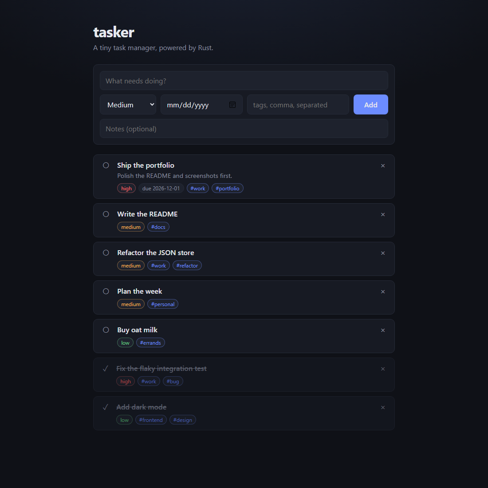

# tasker

A tiny, fast task manager written in Rust, with **two frontends** sharing one
core library: a command-line interface and a server-rendered web UI.

This project is a portfolio piece demonstrating clean Rust architecture:

- **Workspace** with three crates (`core`, `cli`, `web`) and shared dependencies.
- **Core library** owning all business logic, validation, and JSON persistence.
- **CLI** built with [`clap`](https://crates.io/crates/clap).
- **Web UI** built with [`axum`](https://crates.io/crates/axum) + HTMX (no JS build step).
- **Tests** covering the core storage layer.



## Layout

```
.
├── core/          # models, validation, JSON store (shared)
│   ├── src/task.rs
│   ├── src/store.rs
│   ├── src/error.rs
│   └── tests/store.rs
├── cli/           # `tasker` command-line binary
├── web/           # `tasker-web` Axum server + templates + static assets
└── .github/       # CI: fmt, clippy, tests
```

## Getting started

Requires a recent stable Rust toolchain. No external database or native
dependency is needed — tasks are stored in a plain JSON file.

```bash
cargo build --workspace
cargo test --workspace
```

### Demo data

`scripts/` contains helpers that seed a `demo.json` file with seven example
tasks (two already completed) so the UI looks alive right away:

```bash
./scripts/seed.sh      # macOS / Linux
./scripts/seed.ps1     # Windows PowerShell
```

Then run the web UI against it:

```bash
TASKER_DB=demo.json cargo run -p tasker-web
```

On Windows PowerShell:

```powershell
$env:TASKER_DB = "demo.json"; cargo run -p tasker-web
```

### CLI

The CLI and web server share the same JSON data file (`tasks.json` by default,
override with `--db` or the `TASKER_DB` environment variable).

```bash
cargo run -p tasker-cli -- add "Ship the portfolio" --priority high --tag work --due 2026-12-01
cargo run -p tasker-cli -- list
cargo run -p tasker-cli -- list --priority high
cargo run -p tasker-cli -- done 1
cargo run -p tasker-cli -- undone 1
cargo run -p tasker-cli -- edit 1 --title "Ship it faster" --tag urgent
cargo run -p tasker-cli -- delete 1
```

Example output:

```
[ ] #1   high   todo   Ship the portfolio
          due: 2026-12-01
          tags: work
```

### Web UI

```bash
cargo run -p tasker-web
# open http://127.0.0.1:3000
```

The server reads `TASKER_DB` (data file path) and `TASKER_ADDR` (bind address).
Mutations are handled with HTMX partial swaps, so the page updates without a
full reload.

## Design notes

- `core` exposes `Store`, `Task`, `NewTask`, `ListFilter`, and `AppError`.
  Both frontends are thin adapters over this API.
- Errors are modeled with `thiserror`; the web layer maps them to HTTP status
  codes (`404` for missing tasks, `400` for validation failures).
- Tasks have a status (`todo`/`done`), a priority (`low`/`medium`/`high`),
  free-form tags, an optional due date, and optional notes.
- The web layer owns no business logic: handlers lock the shared `Store`, call
  a core method, then render an Askama partial. HTMX swaps that partial into
  `#task-list`, so the page never does a full reload.
- HTMX is vendored under `web/static/`, so the demo works fully offline.
- Listing is sorted by status (open first), then priority (high to low), then
  insertion order.

## License

MIT
